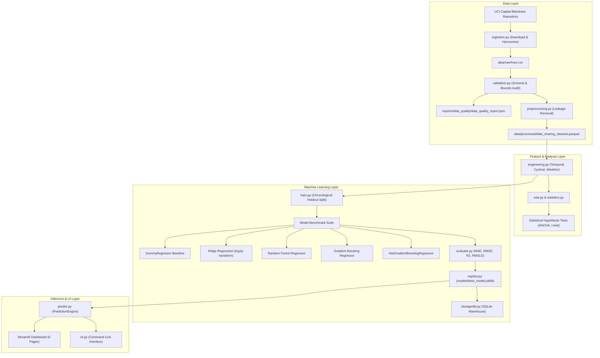

# BSD-Analytics

## Bike Sharing Demand Analytics

Understand demand. Predict smarter. Optimize urban mobility.

---

## 1. Project Overview

BSD-Analytics is an end-to-end data science, machine learning, and business analytics system built for municipal bike-sharing operators, transportation planners, and urban mobility fleets. The product ingests historical hourly ridership and meteorological data from the Capital Bikeshare system, performs automated data quality audits, engineers temporal and weather interaction features, trains and benchmarks multiple regression models using strict chronological holdout validation, and serves real-time predictions through an interactive multi-page dashboard.

Primary Objective: Analyze historical bike rental patterns and predict hourly bike rental demand to optimize fleet staging, station rebalancing, and maintenance operations.

Target Variable: `count`, representing total hourly bike rentals.

---

## 2. Problem Statement and Objectives

Urban bike-sharing systems face extreme demand volatility driven by circadian commuter schedules, weekend recreational shifts, and acute weather sensitivity. Imbalances result in two major operational failures:
1. Dock Starvation: Commuters arrive at residential stations in the morning to find zero bikes available.
2. Dock Saturation: Commuters reach downtown commercial destinations to find zero empty docks to return their bikes, leading to rider frustration and lost revenue.

### Operational Questions Addressed
- What are the busiest rental hours across working days versus weekends?
- Which days, months, and seasons observe peak ridership?
- How do temperature, humidity, and precipitation dictate hourly rental volume?
- How does demand diverge between casual (recreational) and registered (subscriber) users?
- Can historical patterns predict hourly rental demand with high precision?
- How can municipal operators allocate rebalancing vans and schedule overnight maintenance?

---

## 3. Technology Stack

- Language: Python 3.11+
- Data Processing: Pandas, NumPy, SciPy
- Machine Learning: Scikit-learn, Joblib
- Visualization: Plotly, Matplotlib, Seaborn
- Interactive Dashboard: Streamlit
- Storage: CSV, Parquet, SQLite, SQLAlchemy 2.0
- Quality and Engineering: pytest, Ruff, python-dotenv, Click

---

## 4. System Architecture

The following Mermaid diagram outlines the end-to-end dataflow and modular architecture of BSD-Analytics:



---

## 5. Dataset Source and Licensing

- Primary Source: UCI Machine Learning Repository, "Bike Sharing Dataset Data Set" (Hadi Fanaee-T and Joao Gama, Laboratory of Artificial Intelligence and Decision Support, University of Porto).
- Underlying System: Capital Bikeshare, Washington D.C., USA (2011-2012).
- Public Dataset Archive: https://archive.ics.uci.edu/static/public/275/bike+sharing+dataset.zip
- Kaggle Competition Reference: https://www.kaggle.com/c/bike-sharing-demand
- Licensing: Open Database License (ODbL) / CC BY 4.0.

### Dataset Harmonization and Leakage Prevention
The raw dataset contains hourly observations over 24 calendar months (17,379 rows).
Important Data Leakage Rule: In the original data, `casual + registered = count`.
`casual` and `registered` represent post-hoc rental counts split by user subscription tier.
These columns are strictly removed prior to feature matrix generation. Neither `casual` nor `registered` is ever used as an input feature during model training or inference.

---

## 6. Dataset Schema

| Column Name | Type | Description | Values / Units |
| :--- | :--- | :--- | :--- |
| `datetime` | datetime64[ns] | Hourly timestamp | 2011-01-01 00:00:00 to 2012-12-31 23:00:00 |
| `season` | integer | Season classification | 1: Spring, 2: Summer, 3: Fall, 4: Winter |
| `holiday` | integer | Public holiday indicator | 1: Holiday, 0: Regular day |
| `workingday` | integer | Workday indicator | 1: Neither weekend nor holiday, 0: Weekend/Holiday |
| `weather` | integer | Meteorological severity tier | 1: Clear, 2: Mist/Cloudy, 3: Light Rain/Snow, 4: Heavy Storm |
| `temp` | float | Ambient temperature | Continuous degrees Celsius (-5.0 to 41.0 C) |
| `atemp` | float | Apparent feels-like temperature | Continuous degrees Celsius (-16.0 to 50.0 C) |
| `humidity` | float | Relative air humidity | Continuous percentage (0.0 to 100.0%) |
| `windspeed` | float | Wind speed | Continuous km/h (0.0 to 67.0 km/h) |
| `casual` | integer | Non-registered recreational rentals | Informational only (stripped during preprocessing) |
| `registered` | integer | Annual subscriber commuter rentals | Informational only (stripped during preprocessing) |
| `count` | integer | Total bike rentals (Target) | Target variable (>= 0) |

---

## 7. Feature Engineering

The `FeatureEngineer` transformer extracts domain-specific signals across three dimensions:

### A. Temporal Features
- `hour`: Hour of the day (0 to 23).
- `day`: Day of the month (1 to 31).
- `weekday`: Day of the week (0 = Monday, 6 = Sunday).
- `month`: Calendar month (1 to 12).
- `year`: Calendar year (2011 or 2012, capturing macro network adoption).
- `is_weekend`: Binary flag for Saturday or Sunday.
- `peak_commute_hour`: Binary indicator for working day rush hours (07:00-09:00 and 17:00-19:00).

### B. Cyclical Encodings
Because hour 23 and hour 0 are contiguous, linear encodings create artificial boundary penalties. Periodic trigonometric transformations preserve continuity:
- `hour_sin` = $\sin(2\pi \cdot \text{hour} / 24)$
- `hour_cos` = $\cos(2\pi \cdot \text{hour} / 24)$
- `month_sin` = $\sin(2\pi \cdot \text{month} / 12)$
- `month_cos` = $\cos(2\pi \cdot \text{month} / 12)$

### C. Meteorological Interaction Indices
- `temp_feels_diff`: $atemp - temp$ (captures perceived thermal comfort deviation).
- `temp_humidity_ratio`: $temp / (humidity + 1.0)$ (thermal heat index proxy).
- `wind_chill_approx`: Approximated wind-chill cooling index for outdoor exposure.
- `bad_weather_flag`: Binary indicator where weather category is 3 or 4 (precipitation).

---

## 8. Validation Strategy and Model Experiments

### Chronological Holdout Validation
Random k-fold cross-validation introduces severe temporal look-ahead leakage in time-dependent demand series. BSD-Analytics enforces strict time-aware splitting:
- Training Period: 2011-01-01 00:00:00 through 2012-06-30 23:00:00 (13,003 hourly observations, ~75%).
- Chronological Holdout Evaluation: 2012-07-01 00:00:00 through 2012-12-31 23:00:00 (4,376 hourly observations, ~25%).

All models are trained with log-transformed targets (`log1p(count)`) to accommodate the right-skewed count distribution and mathematically ensure non-negative predictions upon back-transformation (`expm1`).

### Empirical Benchmark Results

Evaluated strictly on the unseen future holdout period (July to December 2012):

| Model Name | MAE (bikes/hr) | RMSE (bikes/hr) | R-squared | RMSLE | Status |
| :--- | :--- | :--- | :--- | :--- | :--- |
| **Gradient Boosting Regressor (GBDT)** | **49.61** | **75.91** | **0.8806** | **0.3749** | **Selected Production Model** |
| HistGradientBoostingRegressor | 49.75 | 77.16 | 0.8767 | 0.3706 | Secondary Candidate |
| Random Forest Regressor | 55.70 | 84.29 | 0.8528 | 0.4058 | Benchmark Ensemble |
| Ridge Regression (alpha=1.0) | 113.75 | 186.50 | 0.2794 | 0.7168 | Linear Baseline |
| DummyRegressor (Strategy=Mean) | 177.39 | 236.06 | -0.1546 | 1.4063 | Empirical Floor |

### Model Selection Rationale
Gradient Boosting Regressor achieved the lowest holdout Mean Absolute Error (49.61 bikes/hr) and highest R-squared (0.8806), explaining 88.1% of all future variance. GBDT outperforms Random Forest and linear alternatives due to sequential residual minimization across non-linear weather interaction thresholds.

---

## 9. Key Analytical Findings

1. Circadian Bimodal Commuting:
   On working days, demand concentrates in two pronounced spikes: 08:00 AM (inbound commute) and 17:00-18:00 PM (outbound commute). On weekends, demand transitions to a unimodal bell curve peaking between 13:00 and 16:00 PM.
2. User Segmentation:
   Registered subscribers generate 81.2% of all historical rides, maintaining steady commuter volume across mild weather variations. Casual users contribute 18.8% of demand and exhibit extreme weather elasticity, surging on warm weekend afternoons.
3. Temperature Sensitivity:
   Ambient temperature exhibits a strong positive correlation with rental volume (Pearson r = 0.405, p < 0.001) up to approximately 32 C, above which heat exhaustion dampens demand.
4. Precipitation Penalties:
   One-way ANOVA across weather conditions confirms highly significant variance (F = 127.17, p < 0.001). Adverse weather (category 3 and 4) causes an immediate ridership drop exceeding 50% relative to clear conditions.

---

## 10. Installation and Quickstart

### Prerequisites
- Python 3.11 or higher
- Git

### Installation
```bash
# Clone the repository
git clone https://github.com/hardikkaurani/BSD-Analytics.git
cd BSD-Analytics

# Install package in editable mode with development dependencies
pip install -e .[dev]
```

### Environment Configuration
```bash
cp .env.example .env
```

---

## 11. Command Line and Pipeline Execution

Execute the automated pipeline using either standard Python scripts or the registered Click CLI:

### 1. Data Ingestion
```bash
python scripts/download_data.py
# Or via CLI
bsd-analytics download
```

### 2. Preprocessing & Quality Audit
```bash
python scripts/run_pipeline.py
# Or via CLI
bsd-analytics pipeline
```

### 3. Model Training & Benchmark Serialization
```bash
python scripts/train_model.py
# Or via CLI
bsd-analytics train
```

### 4. Real-Time Demand Forecasting
```bash
bsd-analytics predict --datetime "2026-06-15 08:00:00" --temp 24.0 --humidity 55.0 --windspeed 12.0
```

---

## 12. Streamlit Dashboard

Launch the interactive 6-page analytics and forecasting dashboard:

```bash
streamlit run dashboard/app.py
```

### Dashboard Pages
1. Executive Overview: Topline volume metrics, daily historical ridership growth, and executive takeaways.
2. Demand Analysis: Hourly demand curves, weekday vs weekend comparisons, seasonal bars, and user breakdown.
3. Weather Insights: Temperature, humidity, windspeed scatter plots, ANOVA test outputs, and correlation heatmap.
4. Demand Forecasting: Interactive input form to test weather and calendar scenarios with instant predictions.
5. Model Performance: Benchmark leaderboard table, actual vs predicted scatter, residual error histograms, and feature importance rankings.
6. Business Insights: Actionable operational strategies, fleet rebalancing schedules, and maintenance windows.

---

## 13. Automated Testing and Quality

Run the complete test suite:

```bash
pytest tests/ -v
```

Run code formatting and linting checks:

```bash
ruff check .
ruff format --check .
```

---

## 14. Deployment Readiness

The BSD-Analytics dashboard is configured for direct deployment on Streamlit Community Cloud:
- Root entrypoint: `dashboard/app.py`
- Package dependencies: `requirements.txt`
- Pre-trained model artifact: `models/best_model.joblib` and `models/best_model_metadata.json`
- CI/CD workflow: Defined in `ci/workflow.yml` for automated linting, test verification, and multi-Python validation.

---

## 15. Operational Limitations and Future Improvements

### Limitations
- Aggregate Predictions: The current model forecasts system-wide hourly demand. It does not predict micro-level station-by-station dock shortages.
- Extreme Outliers: Major weather anomalies (hurricanes, blizzards) and localized transit disruptions fall outside regular training distributions.
- Uncaptured External Events: Public concerts, sports games, and city marathons require external event feed integrations.

### Future Improvements
- Spatial Graph Modeling: Implement Graph Neural Networks (GNNs) or spatial regression for station-level origin-destination pair forecasting.
- Real-Time Weather API Integration: Connect live weather forecasts (e.g. Open-Meteo or NOAA API) to auto-generate 24-hour forward look-ahead schedules.
- Dynamic Rebalancing Routing: Couple demand predictions with Vehicle Routing Problem (VRP) solvers for optimal van dispatch itineraries.

---

## 16. License and Attribution

Distributed under the MIT License. See `LICENSE` for details.

Developed and maintained by Hardik Kaurani.
Based on research data provided by Capital Bikeshare and the UCI Machine Learning Repository.
